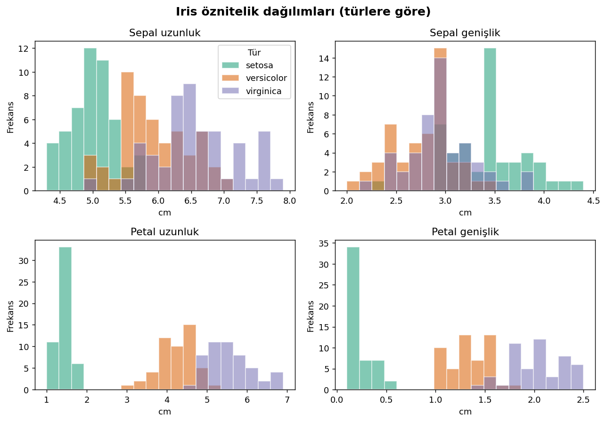
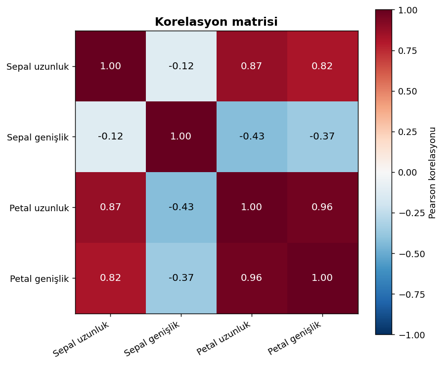
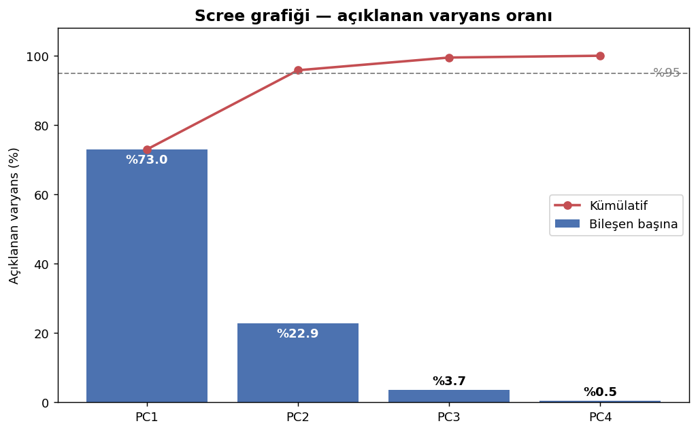
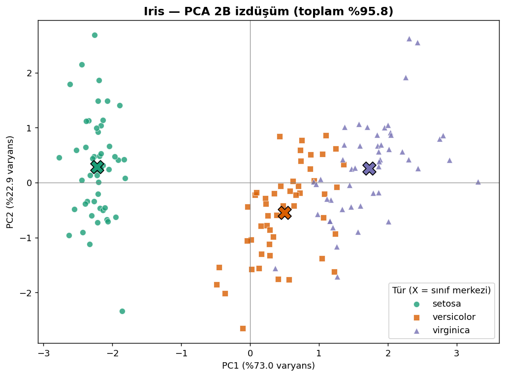
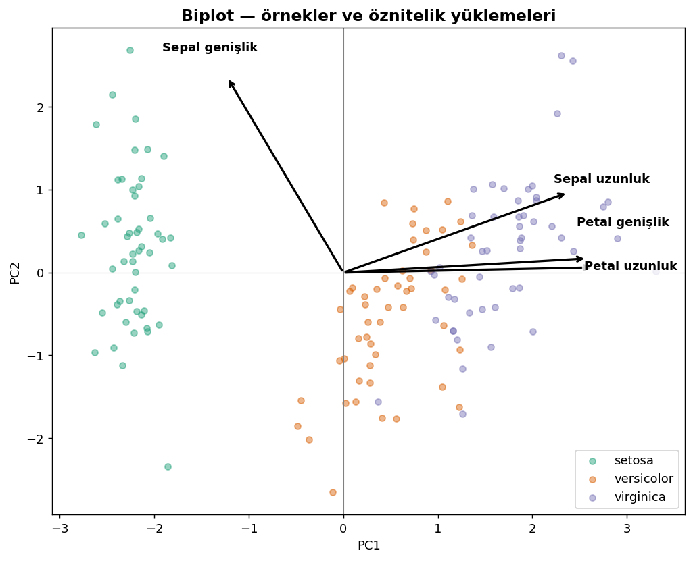
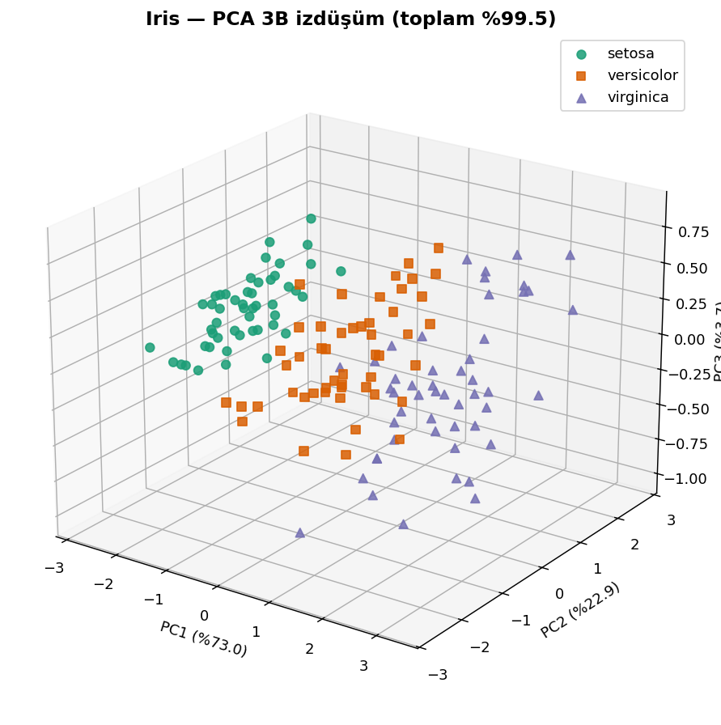
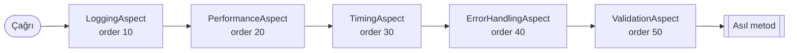
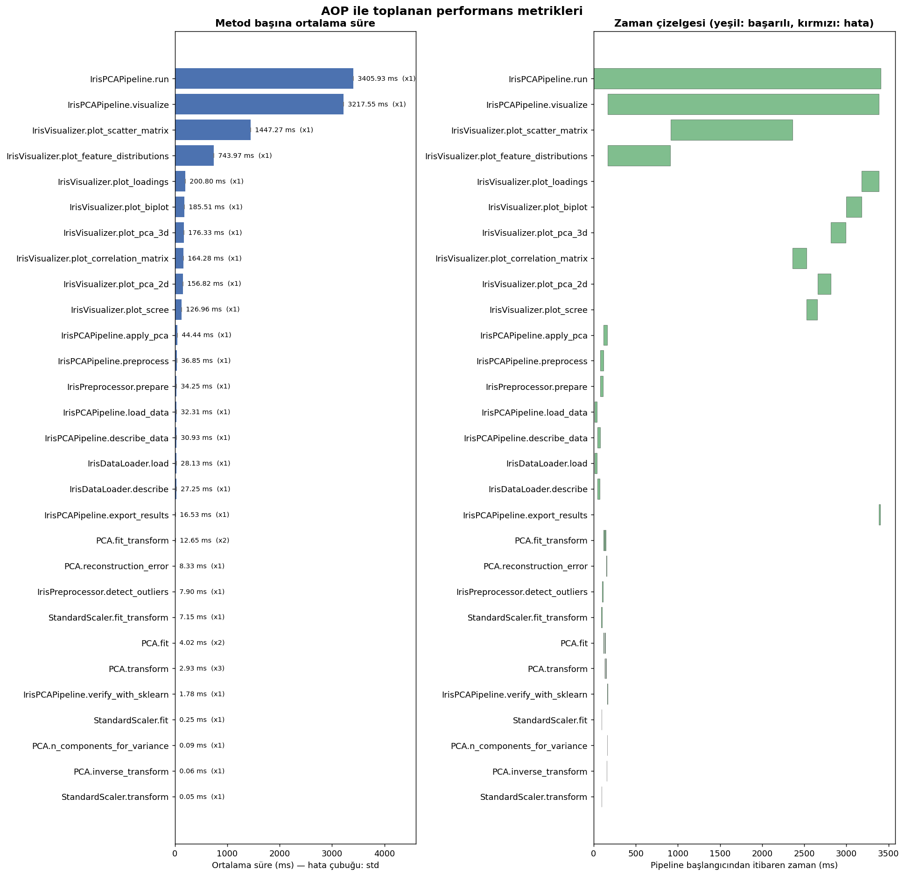

# Iris Veri Seti Üzerinde PCA ve AOP ile İzleme


Bu proje, makine öğrenmesinde sık kullanılan **Iris veri seti** üzerinde **Temel Bileşenler Analizi (PCA)** uygular. Uygulamanın her adımı **Aspect Oriented Programming (AOP)** yaklaşımıyla izlenir, loglanır ve performans açısından ölçülür.

PCA algoritması NumPy ile sıfırdan yazılmıştır ve sonuçları scikit-learn ile karşılaştırılarak doğrulanır (maksimum fark `~1e-15`). AOP katmanı da projeye özel olarak yazılmış, dış bağımlılığı olmayan küçük bir çatıdır. Loglama, zamanlama, veri doğrulama, hata yönetimi ve metrik toplama kodlarının **hiçbiri iş sınıflarının içinde yer almaz**; hepsi aspect'ler aracılığıyla dışarıdan eklenir.

---

## İçindekiler

- [Özellikler](#özellikler)
- [Kurulum](#kurulum)
- [Kullanım](#kullanım)
- [Proje Yapısı](#proje-yapısı)
- [Iris Veri Seti](#iris-veri-seti)
- [PCA Analizi](#pca-analizi)
- [AOP Mimarisi](#aop-mimarisi)
- [Log Yönetimi](#log-yönetimi)
- [Performans Metrikleri](#performans-metrikleri)
- [Hata Yönetimi](#hata-yönetimi)
- [Testler](#testler)
- [Grup Üyeleri](#grup-üyeleri)
- [Lisans](#lisans)

---

## Özellikler

| Alan | Açıklama |
|------|----------|
| **Veri yükleme ve ön işleme** | scikit-learn'deki gömülü kopyadan veya CSV dosyasından yükleme, eksik değer kontrolü, tekrar eden satır ve IQR yöntemiyle aykırı değer analizi, z-skor standardizasyonu |
| **Veri setinin tanıtımı** | Öznitelik açıklamaları, sınıf dağılımı, betimsel istatistikler, sınıf ortalamaları, korelasyon matrisi |
| **PCA** | Kovaryans matrisi ve özdeğer ayrışımı (NumPy), açıklanan varyans, yükleme matrisi, ters dönüşüm, yeniden yapılandırma hatası, scikit-learn ile doğrulama |
| **Görselleştirme** | 9 grafik: dağılımlar, saçılım matrisi, korelasyon, scree, 2B/3B PCA, biplot, yükleme ısı haritası, performans grafiği |
| **AOP** | 5 aspect: `Logging`, `Performance`, `Timing`, `ErrorHandling`, `Validation` |
| **Loglar** | Konsol + dönen (rotating) `.log` dosyası + yalnızca hata dosyası + yapılandırılmış JSON Lines |
| **Metrikler** | Metod bazında çağrı sayısı, ortalama/min/maks/std süre, CPU süresi, tepe bellek; JSON/CSV çıktısı |
| **Hata yönetimi** | Yeniden deneme (exponential backoff), yedek davranış (fallback), hata sarmalama, özel hata hiyerarşisi |

---

## Kurulum

```bash
git clone https://github.com/<kullanici-adi>/iris-pca-aop.git
cd iris-pca-aop
python -m venv .venv
# Windows: .venv\Scripts\activate   |   Linux/macOS: source .venv/bin/activate
pip install -r requirements.txt
```

Gereksinimler: Python 3.10+, NumPy, pandas, Matplotlib, scikit-learn, pytest.

---

## Kullanım

```bash
python main.py                      # Tam pipeline (2 bileşenli PCA)
python main.py --n-components 3     # 3 bileşenli PCA
python main.py --log-level DEBUG    # Zamanlama ve doğrulama ayrıntılarını konsolda da göster
python main.py --demo-errors        # Hata yakalama senaryolarını da çalıştır
python main.py --data iris.csv      # Veriyi CSV dosyasından oku
python main.py --no-plots           # Grafik üretmeden çalıştır
```

| Parametre | Varsayılan | Açıklama |
|-----------|-----------|----------|
| `--n-components` | `2` | PCA bileşen sayısı |
| `--data` | – | İsteğe bağlı Iris CSV dosyası |
| `--output-dir` | `outputs` | Grafik, sonuç ve metrik klasörü |
| `--log-dir` | `logs` | Log klasörü |
| `--log-level` | `INFO` | Konsol log seviyesi (dosyalara her zaman DEBUG yazılır) |
| `--slow-ms` | `1000` | Bu süreyi aşan çağrılar `WARNING` olarak loglanır |
| `--no-plots` | – | Grafik üretme |
| `--demo-errors` | – | 8 kontrollü hata senaryosunu çalıştır |

### Örnek konsol çıktısı

```text
 PC1: özdeğer =  2.9381   açıklanan varyans = % 72.96   kümülatif = % 72.96
 PC2: özdeğer =  0.9202   açıklanan varyans = % 22.85   kümülatif = % 95.81
 PC3: özdeğer =  0.1477   açıklanan varyans = %  3.67   kümülatif = % 99.48
 PC4: özdeğer =  0.0209   açıklanan varyans = %  0.52   kümülatif = %100.00
 Seçilen 2 bileşen toplam varyansın %95.81'ini açıklıyor.
 %95 varyans için gereken bileşen sayısı: 2
 Yeniden yapılandırma hatası (MSE): 0.04187
 scikit-learn ile eşleşme: EVET (maks. skor farkı = 3.11e-15)
```

---

## Proje Yapısı

```text
iris-pca-aop/
├── main.py                         # Komut satırı giriş noktası
├── iris_pca_aop/
│   ├── aop/                        # AOP çatısı
│   │   ├── joinpoint.py            #   JoinPoint: metod çağrısının modeli
│   │   ├── aspect.py               #   Aspect temel sınıfı ve advice türleri
│   │   ├── weaver.py               #   weave() / advise(): aspect'leri sınıflara uygular
│   │   ├── metrics.py              #   MetricsRegistry: metrik deposu, JSON/CSV çıktısı
│   │   ├── formatting.py           #   Loglar için argüman/sonuç özetleme
│   │   └── aspects/
│   │       ├── logging_aspect.py         # İşlem adımlarının loglanması
│   │       ├── timing_aspect.py          # Metod zamanlaması (duvar saati + CPU)
│   │       ├── performance_aspect.py     # Performans metrikleri + bellek (tracemalloc)
│   │       ├── error_handling_aspect.py  # Retry, fallback, hata sarmalama
│   │       └── validation_aspect.py      # Ön/son koşul (pre/post) doğrulaması
│   ├── data/
│   │   ├── loader.py               # IrisDataLoader: yükleme + veri seti özeti
│   │   └── preprocessing.py        # StandardScaler, aykırı değer analizi
│   ├── pca/pca.py                  # NumPy ile PCA implementasyonu
│   ├── validation/rules.py         # Iris/PCA'ya özgü doğrulama kuralları
│   ├── visualization/plots.py      # Tüm grafikler
│   ├── pipeline.py                 # İş akışı (yalnızca iş mantığı)
│   ├── bootstrap.py                # Aspect'lerin oluşturulup dokunduğu tek yer
│   ├── logging_config.py           # Log yönetimi yapılandırması
│   ├── config.py                   # PipelineConfig
│   ├── exceptions.py               # Özel hata hiyerarşisi
│   └── demo.py                     # Hata yakalama senaryoları
├── tests/                          # 33 birim ve entegrasyon testi
├── outputs/                        # Örnek çıktılar (grafikler, sonuçlar, metrikler)
└── docs/ornek_loglar/              # Örnek log dosyaları
```

---

## Iris Veri Seti

Iris veri seti, R. A. Fisher tarafından 1936'da yayımlanmıştır. Üç iris türüne ait **150 çiçek örneğini** içerir.

| Özellik | Değer |
|---------|-------|
| Örnek sayısı | 150 |
| Öznitelik sayısı | 4 (hepsi sayısal, cm) |
| Sınıflar | *setosa*, *versicolor*, *virginica* (her biri 50 örnek, dengeli) |
| Eksik değer | 0 |
| Tekrar eden satır | 1 (gerçek bir gözlem olabileceği için silinmedi) |
| Aykırı değer (IQR) | Yalnızca `sepal_width` sütununda 4 adet |

| Öznitelik | Açıklama | Ortalama | Std | Min | Maks |
|-----------|----------|---------:|----:|----:|-----:|
| `sepal_length` | Çanak yaprak uzunluğu | 5.84 | 0.83 | 4.3 | 7.9 |
| `sepal_width` | Çanak yaprak genişliği | 3.06 | 0.44 | 2.0 | 4.4 |
| `petal_length` | Taç yaprak uzunluğu | 3.76 | 1.77 | 1.0 | 6.9 |
| `petal_width` | Taç yaprak genişliği | 1.20 | 0.76 | 0.1 | 2.5 |

`petal_length` ile `petal_width` arasındaki korelasyon **0.96**'dır. Bu kadar güçlü bir korelasyon, verinin daha az boyutla özetlenebileceğini gösterir. PCA bu durumda iyi sonuç verir.

<p align="center">
  
  
</p>

### Ön işleme adımları

1. **Eksik değer kontrolü**: NaN içeren satırlar çıkarılır. Iris'te eksik değer yoktur.
2. **Tekrar eden satırlar**: Raporlanır. İstenirse `drop_duplicates=True` ile silinebilir.
3. **Aykırı değer analizi**: IQR yöntemi kullanılır (`Q1 − 1.5·IQR`, `Q3 + 1.5·IQR`).
4. **Standardizasyon**: `z = (x − μ) / σ`. PCA varyansa duyarlıdır. Ölçeği büyük olan `petal_length` (varyans 3.12), standardizasyon yapılmazsa analizi tek başına domine eder.

---

## PCA Analizi

### Algoritma

```text
1. Merkezleme          Xc = X − μ
2. Kovaryans matrisi   C  = Xcᵀ Xc / (n − 1)              (4 × 4, simetrik)
3. Özdeğer ayrışımı    C v = λ v                          (numpy.linalg.eigh)
4. Sıralama            λ1 ≥ λ2 ≥ λ3 ≥ λ4
5. İşaret sabitleme    her özvektörde mutlak değeri en büyük eleman pozitif
6. İzdüşüm             Z = Xc · W_k                      (W_k: ilk k özvektör)
```

Açıklanan varyans oranı `λᵢ / Σλ` formülüyle bulunur. Yükleme (loading) değeri `vᵢ · √λᵢ` olarak hesaplanır; veri standardize edildiği için orijinal öznitelik ile bileşen arasındaki korelasyona eşittir.

### Sonuçlar

| Bileşen | Özdeğer | Açıklanan varyans | Kümülatif |
|---------|--------:|------------------:|----------:|
| PC1 | 2.938 | %72.96 | %72.96 |
| PC2 | 0.920 | %22.85 | **%95.81** |
| PC3 | 0.148 | %3.67 | %99.48 |
| PC4 | 0.021 | %0.52 | %100.00 |

| Yükleme | PC1 | PC2 |
|---------|----:|----:|
| sepal_length | **0.89** | 0.36 |
| sepal_width | -0.46 | **0.89** |
| petal_length | **0.99** | 0.02 |
| petal_width | **0.97** | 0.06 |

**Yorum:**

- **PC1** (%73), petal ölçümleri ve sepal uzunluğuyla güçlü pozitif ilişkilidir. Bu bileşen çiçeğin genel **büyüklüğünü** temsil eder ve *setosa*'yı diğer iki türden tamamen ayırır.
- **PC2** (%23) neredeyse yalnızca **sepal genişliğini** temsil eder.
- İlk iki bileşen varyansın **%95.8**'ini korur. 4 boyuttan 2 boyuta inildiğinde kaybolan bilgi azdır (yeniden yapılandırma MSE = 0.042).
- *versicolor* ile *virginica* sınıfları PC1 ekseninde kısmen örtüşür. Bu, bu iki türün birbirine benzediğini gösterir.

<p align="center">
  
  
</p>
<p align="center">
  
  
</p>

### Doğruluk kontrolü

`verify_with_sklearn` adımı aynı veriyi `sklearn.decomposition.PCA` ile de analiz eder. Özvektör işaretleri hizalandıktan sonra açıklanan varyans oranları, bileşenler ve skorlar `1e-8` toleransı içinde karşılaştırılır. Gözlenen en büyük fark `3.1e-15` olup bu değer kayan nokta hassasiyeti düzeyindedir. Ayrıca `tests/test_pca.py` dosyasındaki testler şu özellikleri kontrol eder:

- Bileşenlerin ortonormal olması
- Skorların birbiriyle korelasyonsuz olması ve varyanslarının özdeğerlere eşit olması
- Tüm bileşenler kullanıldığında ters dönüşümün veriyi birebir geri üretmesi
- Yeniden yapılandırma hatasının, atılan özdeğerlerin toplamıyla uyumlu olması

---

## AOP Mimarisi

**Aspect Oriented Programming**, programın pek çok yerine dağılan *kesişen ilgileri* (cross-cutting concerns) tek bir modülde toplar. Loglama, zamanlama, doğrulama ve hata yönetimi bu tür ilgilere örnektir. AOP olmadan her metodun başına ve sonuna `logger.info(...)`, `time.perf_counter()`, `try/except` blokları eklemek gerekir. Bu da kod tekrarına ve iş mantığının bu kodların arasında kaybolmasına yol açar.

### Temel kavramlar

| Kavram | Bu projedeki karşılığı |
|--------|------------------------|
| **Join point** | Her metod çağrısı → `JoinPoint` nesnesi (hedef, argümanlar, sonuç, hata, derinlik) |
| **Pointcut** | Glob desenleri: `"*"`, `"PCA.fit"`, `"IrisVisualizer.plot_*"` |
| **Advice** | `before`, `after_returning`, `after_throwing`, `after`, `around` |
| **Aspect** | `Aspect` alt sınıfları (5 adet) |
| **Weaving** | `weave(cls, aspects)` çalışma anında aspect'li bir **alt sınıf** üretir; orijinal sınıf değişmez |

### Aspect zinciri



Zincirin sırası bilinçli olarak seçilmiştir:

- **Validation** en içtedir. Böylece fırlattığı `DataValidationError`, ErrorHandling tarafından kaydedilir ve Logging tarafından loglanır.
- **ErrorHandling**, Timing'in içindedir. Bu sayede yeniden denemeler ölçülen süreye dâhil edilir.
- **Performance**, Timing'in dışındadır. Timing'in `jp.context` içine yazdığı süreyi okuyarak kaydeder.
- **Logging** en dıştadır. Hem bitiş süresini hem de diğer aspect'lerden gelen hataları görebilir.

### Kullanım örneği

İş sınıfı hiçbir AOP kodu içermez:

```python
class PCA:
    def fit(self, X):
        """PCA modelinin eğitilmesi (kovaryans + özdeğer ayrışımı)"""
        ...
```

Aspect'ler yalnızca `bootstrap.py` içinde uygulanır:

```python
aspects = [
    LoggingAspect(logger),
    PerformanceAspect(registry),
    TimingAspect(logger, registry, slow_threshold_ms=1000),
    ErrorHandlingAspect(logger, registry, max_retries=2,
                        fallbacks={"IrisVisualizer.plot_*": _skip_plot}),
    ValidationAspect(logger, registry, pre=pre_rules, post=post_rules),
]
WovenPCA = weave(PCA, aspects)
WovenPCA(n_components=2).fit(X)   # loglanır, ölçülür, doğrulanır
```

Metodun docstring'inin ilk satırı, loglarda **işlem adımı** olarak kullanılır.

### Aspect'ler

| Aspect | Görevi | Advice |
|--------|--------|--------|
| `LoggingAspect` | Başlangıç, bitiş ve hata loglarını yazar. İç içe çağrıları girintiyle gösterir ve loglara yapılandırılmış alanlar (`event`, `call_id`, `method`, `depth`) ekler | before / after_returning / after_throwing |
| `TimingAspect` | `perf_counter` ile **duvar saati**, `process_time` ile **CPU süresi** ölçer. Eşiği aşan çağrıları `WARNING` olarak loglar | around |
| `PerformanceAspect` | `tracemalloc` ile **tepe bellek** ve **net bellek farkı** ölçer, tüm ölçümleri `MetricsRegistry`'ye yazar | around |
| `ErrorHandlingAspect` | Geçici hatalarda yeniden dener, tanımlı metodlarda yedek davranışa geçer, beklenmeyen hataları `PipelineError` içine sarmalar | around |
| `ValidationAspect` | Girdi (pre) ve çıktı (post) koşullarını kontrol eder (*Design by Contract*) | before / after_returning |

### Doğrulama kuralları (`validation/rules.py`)

| Metod | Aşama | Kurallar |
|-------|-------|----------|
| `IrisDataLoader.load` | post | boş olmama, şema ve sayısal tipler, bilinen tür etiketleri, en az 10 örnek |
| `IrisPreprocessor.prepare` | pre | boş olmama, şema, **eksik değer yok**, sonlu ve **pozitif ölçüm**, bilinen etiketler |
| `IrisPreprocessor.prepare` | post | standardizasyon sonrası ortalama ≈ 0 ve std ≈ 1 |
| `PCA.fit` | pre | sonlu sayısal matris, `1 ≤ n_components ≤ min(n, p)` |
| `PCA.fit` | post | varyans oranları [0, 1] aralığında ve azalan sırada, **bileşenler ortonormal** |
| `PCA.transform` | pre | sonlu matris, öznitelik sayısının eğitimdekiyle aynı olması |
| `PCA.transform` | post | çıktı boyutunun `(n, k)` olması ve değerlerin sonlu olması |

---

## Log Yönetimi

| Hedef | Seviye | Biçim | Amaç |
|-------|--------|-------|------|
| Konsol | `INFO` (değiştirilebilir) | Kısa | Canlı takip |
| `logs/pipeline.log` | `DEBUG` | Ayrıntılı metin | Tam kayıt (zamanlama ve doğrulama ayrıntıları dâhil) |
| `logs/errors.log` | `WARNING` | Ayrıntılı metin | Yalnızca uyarı ve hatalar, traceback'lerle birlikte |
| `logs/pipeline.jsonl` | `DEBUG` | JSON Lines | Makine tarafından analiz (pandas, ELK, jq) |

Tüm log dosyaları `RotatingFileHandler` ile **1 MB**'ı geçtiğinde döndürülür ve en fazla **5 yedek** tutulur. Büyük diziler loga olduğu gibi yazılmaz; yalnızca `ndarray(150, 4):float64` gibi bir özet yazılır. Örnek log dosyaları [`docs/ornek_loglar`](docs/ornek_loglar) klasöründedir.

```text
21:34:23 | INFO  | -> [#1] IrisPCAPipeline.run başladı: Iris PCA iş akışının uçtan uca çalıştırılması
21:34:23 | INFO  |   -> [#2] IrisPCAPipeline.load_data başladı: ADIM 1 - Veri setinin yüklenmesi
21:34:23 | INFO  |     -> [#3] IrisDataLoader.load başladı: Iris veri setinin yüklenmesi
21:34:23 | DEBUG |       [doğrulama:post] dataframe_bos_degil -> OK
21:34:23 | DEBUG |       [doğrulama:post] sema_ve_sayisal_tipler -> OK
21:34:23 | DEBUG |        [zamanlama] IrisDataLoader.load: duvar=28.127 ms, cpu=31.250 ms
21:34:23 | INFO  |     <- [#3] IrisDataLoader.load tamamlandı (28.13 ms) | çıktı: DataFrame(150, 5)
```

```json
{"time": "2026-11-17T21:34:23.934", "level": "INFO", "logger": "iris_pca_aop.aop",
 "message": "-> [#1] IrisPCAPipeline.run başladı: ...", "event": "start",
 "call_id": 1, "method": "IrisPCAPipeline.run", "depth": 0}
```

---

## Performans Metrikleri

`MetricsRegistry` her metod için şu bilgileri tutar: çağrı sayısı, başarılı ve hatalı çağrı sayısı, yeniden deneme sayısı, toplam/ortalama/min/maks/std süre, CPU süresi ve tepe bellek. Çalışma sonunda şu dosyalar üretilir:

| Dosya | İçerik |
|-------|--------|
| `outputs/metrics/performance_metrics.json` | Genel özet, metod özeti, tüm çağrılar, hatalar, doğrulamalar |
| `outputs/metrics/method_summary.csv` | Metod bazında istatistik tablosu |
| `outputs/metrics/call_log.csv` | Her çağrının başlangıç anı, süresi ve belleği (zaman çizelgesi) |
| `outputs/metrics/error_log.csv` | Yakalanan hatalar ve uygulanan eylem (retry/fallback/wrap/raise) |
| `outputs/metrics/validation_log.csv` | Çalıştırılan her doğrulama kuralı ve sonucu |

<p align="center"></p>

> **Not:** `tracemalloc` her bellek ayırmayı izlediği için kodu yavaşlatır. Bu projede Matplotlib çizimleri tracemalloc açıkken yaklaşık 4 kat yavaş çalıştı. Bu nedenle grafik metodları `memory_exclude` ile bellek ölçümünden hariç tutulur; süreleri yine ölçülür. Ölçülen çağrı kalmadığında izleme kapatılır.

---

## Hata Yönetimi

Özel hata hiyerarşisi:

```text
IrisPCAError
├── DataLoadError         veri okunamadı
├── DataValidationError   doğrulama kuralı ihlali (kural adı ve aşama bilgisiyle)
├── PCAError              ör. eğitilmemiş modelle dönüşüm
├── VisualizationError
└── PipelineError         beklenmeyen hatanın sarmalanmış hâli (__cause__ korunur)
```

`ErrorHandlingAspect` stratejisi:

1. **Geçici hata** (`OSError`, `TimeoutError`) → en fazla `max_retries` kez, üstel bekleme ile (0.05 sn, 0.10 sn, ...) yeniden dener.
2. **Yedek davranış** tanımlıysa → hatayı loglar ve yedek sonucu döndürür. Örneğin bir grafik çizilemezse pipeline durmaz (*graceful degradation*).
3. **Alan hatası** (`IrisPCAError`) → kaydeder, loglar ve aynen yeniden fırlatır.
4. **Beklenmeyen hata** → traceback ile loglar ve `PipelineError` içine sarmalar.

Hata, iç içe çağrılarda yalnızca **bir kez** (doğduğu yerde) kaydedilir. Böylece loglar şişmez.

`python main.py --demo-errors` komutunun sonuçları:

| # | Senaryo | Sonuç |
|---|---------|-------|
| 1 | `n_components=10` | `DataValidationError` (kural: `n_components_araligi`) |
| 2 | Veride 3 adet NaN | `DataValidationError` (kural: `eksik_deger_yok`) |
| 3 | Negatif ölçüm değeri | `DataValidationError` (kural: `sonlu_ve_pozitif_olcum`) |
| 4 | Eğitilmemiş modelle `transform` | `PCAError` |
| 5 | 4 öznitelikle eğitilen modele 3 öznitelik vermek | `DataValidationError` (kural: `oznitelik_sayisi_uyumu`) |
| 6 | 2 kez geçici `OSError` | 2 yeniden deneme sonrası **başarılı** |
| 7 | Grafik çizimi sırasında `KeyError` | Yedek davranış, pipeline **devam etti** |
| 8 | Matris yerine metin vermek (`ValueError`) | `PipelineError ← ValueError` |

---

## Testler

```bash
python -m pytest
```

| Dosya | Kapsam |
|-------|--------|
| `tests/test_pca.py` | scikit-learn ile karşılaştırma (k = 1..4), bilinen varyans oranları, ortonormallik, ters dönüşüm, işaret kuralı, StandardScaler |
| `tests/test_aop.py` | Advice sırası, pointcut seçimi, orijinal sınıfın değişmemesi, zamanlama ve bellek ölçümü, doğrulama, retry/fallback/sarmalama, logların içeriği |
| `tests/test_pipeline.py` | Uçtan uca çalışma, grafik üretimi, NaN/geçersiz parametre/eksik dosya senaryoları, CSV kaynağı |

Sonuç: **33 test, hepsi başarılı.**

---

## Grup Üyeleri

| Ad Soyad | Öğrenci No |
|----------|-----------|
| _Ad Soyad 1_ | _Numara_ |
| _Ad Soyad 2_ | _Numara_ |
| _Ad Soyad 3_ | _Numara_ |

---

## Kaynaklar

- Fisher, R. A. (1936). *The use of multiple measurements in taxonomic problems*. Annals of Eugenics, 7(2), 179–188.
- Jolliffe, I. T. (2002). *Principal Component Analysis* (2. baskı). Springer.
- Kiczales, G. ve ark. (1997). *Aspect-Oriented Programming*. ECOOP'97, LNCS 1241.
- [scikit-learn: Iris veri seti](https://scikit-learn.org/stable/datasets/toy_dataset.html#iris-dataset)
- [Python `logging` belgeleri](https://docs.python.org/3/library/logging.html)

## Lisans

Bu proje [MIT Lisansı](LICENSE) ile lisanslanmıştır.
